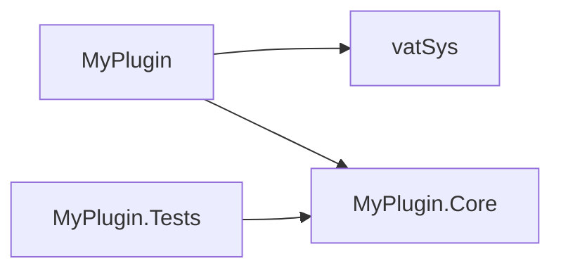
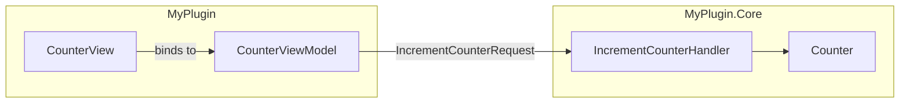

<h1 align="center">
  vatSys Plugin Template
</h1>

<h3 align="center">
  A batteries-included template for building vatSys plugins.

  [](https://github.com/YuKitsune/vatSysPluginTemplate/actions/workflows/build.yml)
  [](https://github.com/YuKitsune/vatSysPluginTemplate/blob/main/LICENSE)
  [](https://github.com/YuKitsune/vatSysPluginTemplate/releases)
  [](https://github.com/Fallout-build/Fallout)
</h3>

## What's Included

- **[vatSys Toolbox](https://github.com/YuKitsune/vatSysToolbox):** The common code that vatSys plugins need. The plugin uses it to report errors, show WPF views in vatSys windows, do background work, and send messages to other plugins. The toolbox is configured and ready to use.
- **[MediatR](https://github.com/LuckyPennySoftware/MediatR):** Sends requests from the plugin to the handlers in `MyPlugin.Core`. Thus, the logic of the plugin stays separate from vatSys. It also handles the messages from other plugins.
- **[MVVM Community Toolkit](https://learn.microsoft.com/dotnet/communitytoolkit/mvvm/):** Makes the view models of the WPF windows. It generates the properties and the commands that the views bind to.
- **[Polyfill](https://github.com/SimonCropp/Polyfill):** Adds the newer C# features and .NET APIs to .NET Framework 4.7.2, which vatSys uses. Thus, you can use records and `init` properties in the plugin.
- **[xUnit](https://xunit.net/), [Shouldly](https://docs.shouldly.org/), and [NSubstitute](https://nsubstitute.github.io/):** Test `MyPlugin.Core`. The tests do not need vatSys, thus they run on Windows, macOS, and Linux.
- **[Fallout](https://github.com/Fallout-build/Fallout):** Builds the plugin. It compiles, tests, installs, packages, and releases the plugin, with the same commands on your computer and in GitHub Actions. It also downloads vatSys, so you do not need vatSys installed to build the plugin.
- **[ILRepack](https://github.com/gluck/il-repack):** Merges the dependencies into the plugin assembly. This prevents conflicts with other plugins that use different versions of the same assemblies. See [ILRepack](#ilrepack).
- **[release-please](https://github.com/googleapis/release-please):** Makes the releases from the commit messages. It updates the changelog and the version, and creates the GitHub release. See [Distribution](#distribution).
- **GitHub workflows:** Build and test each push and pull request, and upload the plugin to each release.

## Getting Started

### Prerequisites

You can build and test most of your plugin on Windows, macOS, or Linux. But vatSys runs only on Windows. Thus, to build the plugin, install it, and try it in vatSys, you must use Windows.

On all computers, you need:

- The .NET SDK, version 10.0.401 or later. This is the version that `global.json` specifies. Get it from the [.NET download page](https://dotnet.microsoft.com/download).
- A GitHub account. The `vatSysToolbox` package is on GitHub Packages, and you need a GitHub token to download it. [Configuring NuGet and GitHub secrets](#configuring-nuget-and-github-secrets) tells you how to make the token.

On the Windows computer where you run the plugin, you also need:

- [vatSys](https://virtualairtrafficsystem.com/), with a profile to install the plugin into.
- .NET Framework 4.7.2 or later. Most Windows computers already have it.

You do not need vatSys to build the plugin. It will be downloaded automatically as part of the build process.

### Installing Fallout

The build uses [Fallout](https://github.com/Fallout-build/Fallout). To install it, run this command in the root of the repository:

```shell
dotnet tool restore
```

Then run the build targets with `dotnet fallout <target>`. For example:

```shell
dotnet fallout Compile
```

If you do not want to install the tool, use the build scripts in place of `dotnet fallout`: `./build.sh` on macOS and Linux, or `.\build.cmd` on Windows.

### Configuring NuGet and GitHub secrets

The plugin uses [vatSysToolbox](https://github.com/YuKitsune/vatSysToolbox). vatSysToolbox is in the GitHub Packages NuGet feed. This feed requires authentication, even for public packages. You must supply a GitHub token to NuGet before you can restore the packages.

1. Make a GitHub personal access token (classic) with the `read:packages` scope.
2. Add the NuGet feed with your GitHub username and your token:

    ```shell
    dotnet fallout AddNuGetSource --nuget-username <username> --nuget-token <token>
    ```

The GitHub workflows also need the packages. You'll need to add it as a secret to your repository:

1. In the repository, go to **Settings** > **Secrets and variables** > **Actions**.
2. Add the `NUGET_USERNAME` secret, with your GitHub username.
3. Add the `NUGET_TOKEN` secret, with your token.

release-please opens the release pull request with the `GITHUB_TOKEN` of the workflow. GitHub does not let `GITHUB_TOKEN` open pull requests unless you allow it. In **Settings** > **Actions** > **General**, select **Allow GitHub Actions to create and approve pull requests**.

### Bootstrapping the plugin

The template uses these names:

- `My Plugin`: The display name of the plugin shown in vatSys.
- `MyPlugin`: The name of the projects, the solution, the assemblies, the root namespaces, and the plugin directory. It must be a valid C# namespace.
- `dev.example.my-plugin`: The mailbox name. Other plugins use this name to send messages to your plugin. Use a lowercase reverse DNS name.

To replace them with the names of your plugin:

1. Select **Use this template** on GitHub to make your repository, then clone it.
2. Run the `Bootstrap` target:

    ```shell
    dotnet fallout Bootstrap --plugin-name "Hold Plugin" --project-name HoldPlugin --mailbox-name dev.example.hold
    ```

3. Commit the changes.

The `Bootstrap` target will configure the project with the values you provide.

The target runs only when the `.template` file exists. Thus, you can run it only one time.

### Installing the plugin

To compile the plugin and install it in a vatSys profile, run this command on Windows:

```shell
dotnet fallout Install --profile-name "<profile name>"
```

The `Debug` configuration installs the plugin to `Documents\vatSys Files\Profiles\<profile name>\Plugins\MyPlugin - Debug`.

The build compiles the plugin with a copy of vatSys that it downloads to `.fallout/temp`. To compile with a different vatSys installation, set `--vat-sys-path`.

To remove the plugin from the profile:

```shell
dotnet fallout Uninstall --profile-name "<profile name>"
```

### Testing the plugin

To run the tests:

```shell
dotnet fallout Test
```

The tests do not use vatSys. You can run them on Windows, macOS, and Linux.

The `build` workflow runs the tests for each push and pull request to `main`. The `Package` target also runs them, thus a release cannot contain a plugin that fails its tests.

## Project Structure

- `MyPlugin`: The vatSys plugin. vatSys loads this assembly. It connects vatSys to the logic in `MyPlugin.Core`. It also contains the windows and the menu items. This is the only project that references vatSys.
- `MyPlugin.Core`: The logic of the plugin. It does not reference vatSys. It targets .NET Framework 4.7.2 for the plugin, and .NET 10 for the tests. Thus, you can develop it on Windows, macOS, and Linux.
- `MyPlugin.Tests`: The xUnit tests of `MyPlugin.Core`. It targets .NET 10, and it does not reference `MyPlugin`.
- `build`: The Fallout build. It compiles, tests, installs, packages, and releases the plugin.



### The example counter

The template contains a small example, so you can see how the projects work together. Replace it with the functionality of your plugin.

1. In vatSys, select `My Plugin` in the `Tools` menu. The plugin opens the counter window.
2. The window shows the value of the counter. When you click `INCREMENT`, the `CounterViewModel` sends an `IncrementCounterRequest` with MediatR.
3. The `IncrementCounterHandler` in `MyPlugin.Core` adds one to the `Counter`, and returns the new value.
4. The view model sets its `Count` property to the new value, and the window shows it.



The view model uses the [MVVM Community Toolkit](https://learn.microsoft.com/dotnet/communitytoolkit/mvvm/). `[ObservableProperty]` makes the `Count` property, and `[RelayCommand]` makes the `IncrementCommand` that the button binds to. `MyPlugin.Tests` tests the handlers and the counter.

## Distribution

The plugin uses [release-please](https://github.com/googleapis/release-please) and [Conventional Commits](https://www.conventionalcommits.org/) to make releases:

1. When you push commits to `main`, the `build` workflow compiles the plugin and runs the tests.
2. The `release-please` workflow opens or updates the release pull request. The pull request updates `CHANGELOG.md` and `version.txt` from the commit messages.
3. When you merge the release pull request, release-please creates the `v<version>` tag and the GitHub release. The release notes are the new entry in `CHANGELOG.md`.
4. The `release-please` workflow then starts the `release` workflow on the tag. The `Release` target builds the plugin, and uploads the zip file to the release.

The zip file contains the plugin assembly, `unblock-dlls.bat`, `CHANGELOG.md`, and `version.txt`.

On `main` and on release tags, the build uses the version in `version.txt`. On other branches, the build does not set a version. Thus, the assembly has the version in the project file (`0.0.0`), and the name of the zip file has the short commit hash (for example, `MyPlugin.1a2b3c4.zip`). To build a different version, set `--force-version`.

The `build` workflow does not run for the release pull request, because GitHub does not run workflows for pull requests that `GITHUB_TOKEN` opens. It runs when you merge the pull request into `main`.

### ILRepack

vatSys loads all the plugins into the same process. If two plugins use different versions of the same assembly (for example, vatSysToolbox or MediatR), vatSys can load only one of the versions. Then one of the plugins can use the incorrect version, and fail.

To prevent this, the build uses [ILRepack](https://github.com/gluck/il-repack) to merge `MyPlugin.Core` and all the other dependencies into `MyPlugin.dll`. Each plugin then has its own copy of its dependencies, inside its own assembly. The `Install` and `Package` targets both merge the assemblies.

Some assemblies must stay separate. For example, [Harmony](https://github.com/pardeike/Harmony) shares the patches of all the plugins that use it. If you merge it into your plugin, that shared state can break.

To keep an assembly separate, add its file name to `RepackExcludedAssemblyFileNames` in `build/Build.cs`. The template has Harmony in the list as an example, but it is commented out. If your plugin uses Harmony, uncomment it:

```csharp
static readonly string[] RepackExcludedAssemblyFileNames =
[
    // Harmony must stay a separate assembly. Do not merge it into the plugin assembly.
    "0Harmony.dll",
];
```

The build then copies the assembly next to `MyPlugin.dll`, and the zip file contains it.

## Resources

- [Fallout](https://github.com/Fallout-build/Fallout)
- [vatSys Toolbox](https://github.com/YuKitsune/vatSysToolbox)
